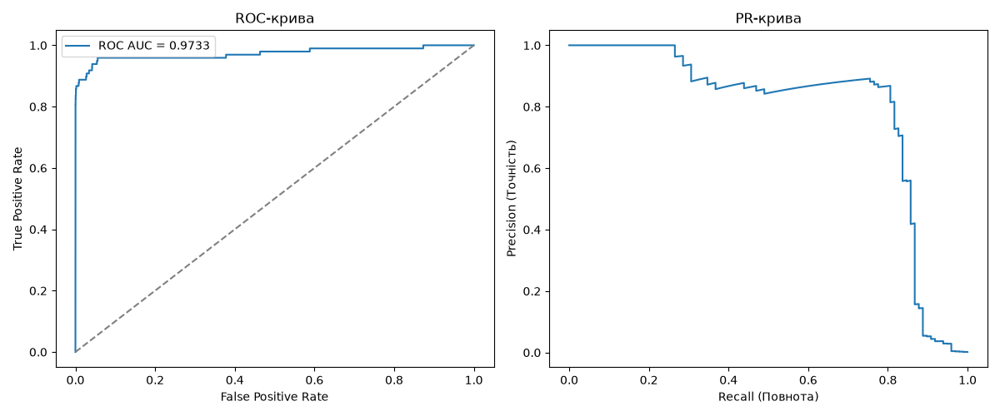

# Лабораторна робота №2. Поріг рішення під асиметричну ціну помилок

### Набір даних

**Джерело даних:** Файл `creditcard.csv` не додано до репозиторію. Використовується набір даних Kaggle **mlg-ulb/creditcardfraud**. Завантажити його можна за посиланням: [Credit Card Fraud Detection](https://www.kaggle.com/datasets/mlg-ulb/creditcardfraud). 
*Примітка: Для завантаження з Kaggle потрібен обліковий запис.*
Після завантаження та розпакування архіву, збережіть файл у папку lab2.

## Підготовка середовища
Проєкт використовує пакетний менеджер `uv` та вимагає **Python 3.12**.
Виконайте наступні команди в терміналі для ініціалізації проєкту та встановлення залежностей:

```bash
uv init --python 3.12
uv add numpy pandas scikit-learn torch matplotlib
```

## Запуск коду

Проєкт містить дві основні команди для роботи. Навчання моделі та генерація прогнозів виконується лише один раз. Подальший аналіз проводиться на збережених прогнозах.

**1. Навчання моделі та збереження прогнозів (виконується один раз):**
```bash
uv run python lab2_starter.py --data creditcard.csv --out results
```
*Ця команда створить теку `results` із збереженими вагами моделі та прогнозами.*

**2. Аналіз зі збережених прогнозів (без повторного навчання):**
```bash
uv run python lab2_analysis.py --saved results
```

## 1. Навчання та збереження прогнозів

Дані були поділені на три вибірки (train/validation/test) у пропорції 60/20/20 зі збереженням стратифікації за класом. Спочатку виконувався поділ із test_size=0.4 та подальшим поділом відкладених індексів навпіл (test_size=0.5) за допомогою train_test_split із фіксованим зерном random_state=0. Для навчання моделі використовувалося 29 ознак (V1-V28 та Amount). Поля Class та Time до входу моделі не включалися. Сирі значення Amount були збережені окремо для подальшого аналізу помилок. Ознаки стандартизувалися за допомогою класу StandardScaler.

### Статистика розбиття:

| **Вибірка** | **Об'єктів** | **Шахрайських** | **Частка** |
| --- | --- | --- | --- |
| Train | 170 884 | 295 | 0.001726 |
| Validation | 56 961 | 98 | 0.001720 |
| Test | 56 962 | 99 | 0.001738 |

**Чому статистики стандартизації не можна обчислювати на всьому наборі?** Статистики для `StandardScaler` (середнє значення та дисперсію) необхідно обчислювати виключно на навчальній вибірці (`train`). Якщо обчислити їх на всьому наборі даних одразу, відбудеться витікання даних. Валідаційна та тестова вибірки мають імітувати нові дані. Якщо включити їхні значення в підрахунок загального середнього, інформація про масштаб та розподіл тестових даних непрямо потрапить у процес навчання моделі.

## 2. Вибір порога на валідаційній вибірці

Шахрайство прогнозується за умови, що s ≥ t. Матриця плутанини формується за правилом:
- TP: y = 1 і s ≥ t
- FP: y = 0 і s ≥ t
- FN: y = 1 і s < t
- TN: y = 0 і s < t

Функція вартісті помилок:

$$
C(t) = 10 \cdot FN(t) + FP(t)
$$

(Пропущене шахрайство обходиться вдесятеро дорожче за хибну тривогу. Сирі значення Amount у формулу вартості не входять).

Метрики:

$$
\text{Precision} = \frac{TP}{TP + FP}, \qquad \text{Recall} = \frac{TP}{TP + FN}
$$

### Результати на Validation
* ROC-AUC: 0.973318
* Зафіксований оптимальний поріг (t*): 0.031194

**Метод пошуку порога:**
Пошук виконувався на множині кандидатів, що включала всі унікальні оцінки валідаційної вибірки та $+\infty$ («усі негативні»). Реалізація базувалася на сортуванні та кумулятивних сумах із ціною алгоритму $O(n \log n)$ без повторного проходу по вибірці. За умови досягнення мінімуму вартості на кількох порогах автоматично обирався найбільший із них.

**Графіки кривої точності-повноти (PR) та ROC-кривої:**



**Чому висока ROC-AUC не гарантує малої вартості помилок чи високої точності?**
ROC-AUC оцінює якість сортування за допомогою метрики FPR, у знаменнику якої лежить загальна кількість легітимних транзакцій (FP + TN). Оскільки в цій задачі шахрайства менше 0.2%, легітимних прикладів десятки тисяч. Через такий величезний знаменник навіть сотні помилкових блокувань (FP) дають мізерний відсоток FPR, роблячи ROC-криву «ідеальною». Проте для бізнесу ці сотні FP означають значну вартість помилок C та низьку точність (Precision), адже точність рахується відносно загальної кількості спрацювань моделі.

### Алгоритм пошуку оптимального порога на валідаційній вибірці:
Для знаходження оптимального порога класифікації використовується ефективний векторний алгоритм на основі сортування та кумулятивних сум із часовою складністю $\mathcal{O}(n \log n)$ (де $n$ — розмір валідаційної вибірці), без необхідності повторного проходу по вибірці для кожного кандидата:

1. **Формування множини кандидатів ($T$):**  
   Множина порогів складається з усіх унікальних оцінок (scores) моделі на валідаційній вибірці, до яких примусово додається поріг $+\infty$ (стратегія «усі негативні»). Найменша оцінка відповідає стратегії «усі позитивні».
2. **Сортування та групування:**  
   Оцінки сортуються за спаданням разом із відповідними істинними мітками ($y$). Усі рівні оцінки отримують однаковий булевий прогноз.
3. **Обчислення матриць плутанини через кумулятивні суми:**  
   За допомогою функцій `np.cumsum` для кожного кандидата за один прохід обчислюються суми правильних та хибних спрацювань (`TP`, `FP`, `FN`, `TN`).
4. **Оцінка вартості та розв'язання нічиєї:**  
   Для кожного порога розраховується асиметрична вартість помилок:
   $$C(t) = 10 \cdot FN(t) + FP(t)$$
   Якщо мінімальна вартість досягається на кількох порогах одночасно, алгоритм автоматично обирає найбільший із них ($t^*$).

### Підсумкова таблиця порогів:

| Правило | Поріг | TP | FP | FN | TN | C |
| --- | --- | --- | --- | --- | --- | --- |
| Стандартний | 0.493505 | 72 | 9 | 26 | 56854 | 269 | 
| Мінімум вартості | 0.031194 | 82 | 34 | 16 | 56829 | 194 | 
| Усі негативні | +∞ | 0 | 0 | 98 | 56863 | 980 | 

*(Повна таблиця кандидатів збережена у файлі `validation_thresholds.csv`)*.

## 3. Перевірка реалізації пошуку порога

Реалізація пошуку порога (через сортування й кумулятивні суми) була перевірена прямим перебором на трьох малих наборах даних. Результати збіглися точно.

| Набір | Оцінки | Мітки |
| --- | --- | --- |
| A | 0.9, 0.7, 0.7, 0.4, 0.2, 0.1 | 0, 1, 0, 1, 0, 0 |
| B | 0.9, 0.6, 0.3 | 0, 0, 0 |
| C | 0.8, 0.5 (×11), 0.2 | 1, 1, 0 (×10), 0 |

**Що перевіряють малі набори:**

* Набір A, t* = 0.4: 
Перевіряє, чи коректно алгоритм обробляє "нічиї" в оцінках. Рівні оцінки з різними мітками завжди повинні отримувати однаковий прогноз.  

| Поріг | TP | FP | FN | TN | C |
| --- | --- | --- | --- | --- | --- |
| +∞ | 0 | 0 | 2 | 4 | 20 |
| 0.9 | 0 | 1 | 2 | 3 | 21 |
| 0.7 | 1 | 2 | 1 | 2 | 12 |
| 0.4 | 2 | 2 | 0 | 2 | 2 |
| 0.2 | 2 | 3 | 0 | 1 | 3 |
| 0.1 | 2 | 4 | 0 | 0 | 4 |

* Набір B, t* = +∞: 
Перевіряє крайовий випадок (відсутність позитивних міток). Цей набір гарантує, що алгоритм коректно розглядає та обирає поріг +inf ("усі негативні"), який дає ідеальну вартість C \= 0.

| Поріг | TP | FP | FN | TN | C |
| --- | --- | --- | --- | --- | --- |
| +∞ | 0 | 0 | 0 | 3 | 0 |
| 0.9 | 0 | 1 | 0 | 2 | 1 |
| 0.6 | 0 | 2 | 0 | 1 | 2 |
| 0.3 | 0 | 3 | 0 | 0 | 3 |

* Набір C, t* = 0.8: 
Перевіряє правило розв'язання нічиєї. Алгоритм повинен обрати найбільший можливий поріг серед тих, що дають однаковий мінімум вартості.

| Поріг | TP | FP | FN | TN | C |
| --- | --- | --- | --- | --- | --- |
| +∞ | 0 | 0 | 2 | 11 | 20 |
| 0.8 | 1 | 0 | 1 | 11 | 10 |
| 0.5 | 2 | 10 | 0 | 1 | 10 |
| 0.2 | 2 | 11 | 0 | 0 | 11 |

## 4. Тестова оцінка та аналіз помилок

Оптимальний поріг t* застосовано до тестової вибірки один раз.

### Метрики на Test:

| Поріг | TP | FP | FN | TN | C | Precision | Recall |
| --- | --- | --- | --- | --- | --- | --- | --- |
| 0.031194 | 80 | 43 | 19 | 56820 | 233 | 0.650407 | 0.808081 |

* **Чому якщо знаменник нульовий метрика не визначена?**  
   Якщо модель не робить жодного позитивного прогнозу (тобто $TP + FP = 0$ для точності або $TP + FN = 0$ для повноти), знаменник у формулах Precision та Recall стає нульовим. Ділення на нуль математично не визначене, оскільки за відсутності позитивних спрацювань моделі неможливо оцінити ані її частку правильних відповідей серед усіх спрацювань, ані частку виявлених реальних об'єктів позитивного класу.


### Розбір помилок (Перші 5 FP та FN за номером рядка CSV):

| Рядок | Тип | Мітка | Оцінка s | Amount |  Відстань |
|---:|:---:|:---:|---:|---:|---:|
| 460 | FP | 0 | 0.196159 | 2.00 | 0.164965 |
| 2961 | FP | 0 | 0.080961 | 2.49 | 0.049767 |
| 10783 | FP | 0 | 0.966327 | 89.99 | 0.935133 |
| 13405 | FP | 0 | 0.932032 | 89.99 | 0.900838 |
| 13617 | FP | 0 | 0.922762 | 89.99 | 0.891568 |
| 10497 | FN | 1 | 0.011464 | 3.79 | 0.019730 |
| 52521 | FN | 1 | 0.006373 | 105.99 | 0.024821 |
| 55401 | FN | 1 | 0.005642 | 1.00 | 0.024821 |
| 91671 | FN | 1 | 0.000500 | 290.18 | 0.030694 |
| 93486 | FN | 1 | 0.018352 | 0.00 | 0.012842 |

* **Порівняйте сирі Amount і відстань оцінок від порога для FP та FN. Чи можна за десятьма прикладами судити про причину помилок моделі?**  
   Серед помилок хибнопозитивних (FP) зустрічаються як транзакції з дуже малими сумами, так і з великими (наприклад, 89.99), причому деякі з них мають величезну впевненість моделі (оцінки близько $0.93-0.96$, тобто велика відстань від порога). Серед хибнонегативних (FN) оцінки знаходять дуже близько до порога ($s \approx 0.0005 - 0.018$), тобто модель сильно «сумнівалася», але все ж класифікувала їх як легітимні попри різноманітні суми.
   Чи можна судити про причину? Ні, за десятьма прикладами та однією лише ознакою Amount неможливо судити про причину помилок моделі. Модель приймає рішення на основі 29 ознак, 28 з яких ($V1-V28$) є прихованими компонентами (PCA) без очевидного фізичного змісту. Поведінка моделі формується складними нелінійними взаємозв'язками цих латентних змінних, а не лише сумою транзакції. 

### Висновки

* **Що змінив вибір порога в роботі незмінної моделі?**  
   Вибір нового оптимального порога $t^*$ не змінив саму модель (її ваги, архітектура та вихідні логіти залишилися повністю незмінними). Він змінив виключно правило прийняття рішень — пороги класифікації впевненості, знизивши бар'єр доказів, необхідний для того, щоб помітити транзакцію як шахрайську.

* **Якою була ціна цього рішення в термінах FP і FN?**  
   Зниження порога зі стандартного рівня ($0.5$) до оптимального ($t^* = 0.031194$) суттєво змінило структуру помилок на тестовій вибірці ($N = 56\,962$ об'єктів, з яких 99 — шахрайські):   
   * Кількість пропущених шахрайств (FN) скоротилася до 19.
   * Кількість хибнопозитивних спрацювань (FP) зросла до 43 (заблоковані легітимні транзакції).
   * Завдяки тому, що пропущене шахрайство коштує вдесятеро дорожче за хибну тривогу ($C = 10 \cdot FN + FP$), загальна вартість помилок на тестовій вибірці склала $C = 233$ (для порівняння: стандартний поріг або тривіальні класифікатори давали б значно більші збитки). 

* **Чому результат на validation не гарантує такого самого виграшу на test?**  
   Поріг $t^*$ підбирався під конкретний розподіл і шуми валідаційної вибірки з метою мінімізації емпіричної вартості $C$, що робить результат на validation дещо оптимістичним через специфічне підлаштування. Тестова вибірка є абсолютно незалежною і має власні випадкові флуктуації та відхилення в розподілі, тому на нових даних значення метрик і вартість можуть дещо відрізнятися. 

### Інструменти
Під час виконання лабораторної роботи було використано Gemini для розробки та оптимізації Python-коду, а також структурування та оформлення звіту.